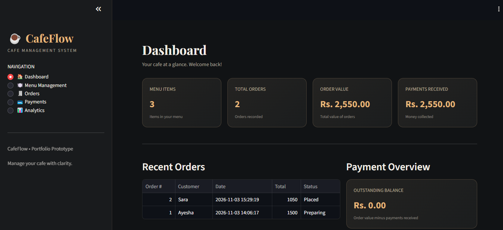
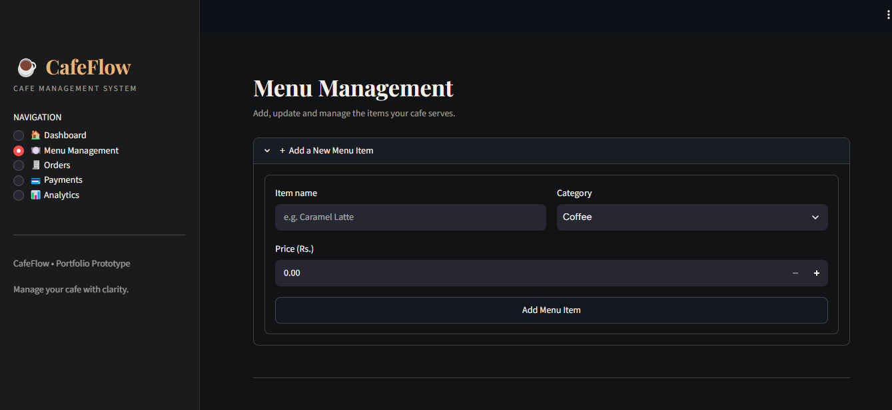
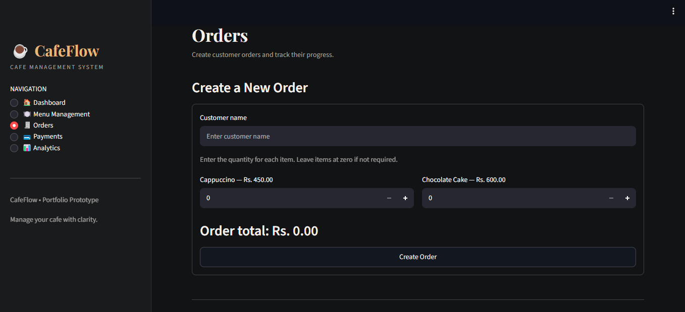

# ☕ CafeFlow — Cafe Management System

A cafe management system prototype built using **Python, Streamlit, and SQLite** to simplify daily cafe operations.

## 📌 Project Overview

CafeFlow provides a simple interface for managing cafe menus, customer orders, payments, and sales analytics.

## ✨ Features

- **Dashboard:** View menu items, total orders, sales, and payment summaries.
- **Menu Management:** Add, edit, and delete menu items.
- **Order Management:** Create customer orders, update order status, and calculate order totals.
- **Payment Processing:** Record full and partial payments and track outstanding balances.
- **Analytics:** View sales charts, payment information, and export reports as CSV files.

# CafeFlow — Cafe Management System

## 📸 Application Preview

### 📊 Dashboard


### 🍔 Menu Management


### 📋 Orders Tracking


### 📈 Analytics & Reports


### 💳 Payments Processing


## 🛠️ Technology Stack

- Python
- Streamlit
- SQLite
- Pandas

## 🚀 Installation and Setup

**1. Clone the repository**

```bash
git clone https://github.com/memoonaismail43-ship-it/CafeFlow-Cafe-Management-System.git
```

**2. Open the project folder**

```bash
cd CafeFlow-Cafe-Management-System
```

**3. Install dependencies**

```bash
pip install -r requirements.txt
```

**4. Run the application**

```bash
streamlit run app.py
```

## 🧪 Testing

Manual functional testing was performed across all five core modules.

See [TESTING.md](TESTING.md) for the testing summary.

## 📊 Project Status

Functional portfolio prototype. Further improvements, automated testing, and deployment preparation are planned.

## 👩‍💻 Developer

**Memoona Ismail**  
BS Software Engineering Student

Interests: Project Management, Software Development, and Artificial Intelligence.
