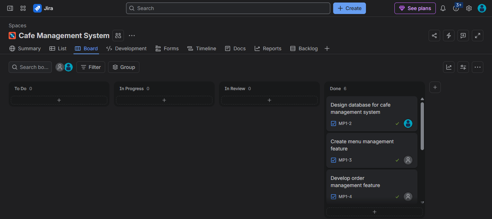

# ☕ CafeFlow — Cafe Management System

A modern cafe management system built with Python, Streamlit, and SQLite to help staff manage orders, inventory, billing, and analytics.

## ✨ Key Features & Overview
* **Dashboard:** Monitor revenue, metrics, and recent activity.
* **Menu Studio:** Manage item availability, pricing, and categories.
* **Order Desk & Billing:** Create customer orders, calculate totals, and generate invoices.
* **Payments & Analytics:** Track full/partial balances, view revenue trends, and export CSV reports.

*(For detailed screenshots of the dashboard, menu, and Jira tracking boards, please see the repository documentation.)*

## 🛠 Technology Stack
* **Core:** Python, Streamlit, SQLite
* **Data/Visuals:** Pandas, Plotly
* **Management:** GitHub, Jira

## 💻 Installation and Setup

### Prerequisites
* Python 3.10 or later
* Git

### 1. Clone the repository
```bash
git clone https://github.com/memoonaismail43-ship-it/CafeFlow-Cafe-Management-System.git
```

### 2. Open the project directory
```bash
cd CafeFlow-Cafe-Management-System
```

### 3. Install dependencies
```bash
pip install -r requirements.txt
```

### 4. Run CafeFlow
```bash
streamlit run app.py
```

---
**Project Status:** Portfolio prototype demonstrating full-stack development and Agile practices.
## 📸 Application & Project Management Preview

### 📊 System Dashboard


### 🍔 Menu Studio


### 📋 Order Desk


### 🗺️ Jira Scrum Board


### 🗂️ Product Backlog

