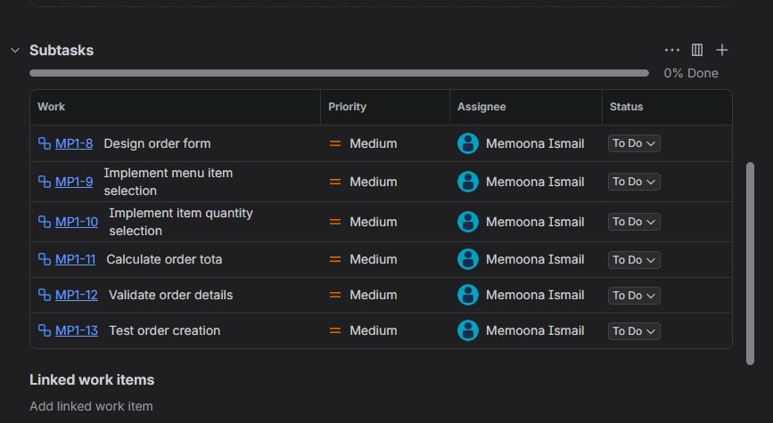

# ☕ CafeFlow — Cafe Management System

A modern cafe management system built with Python, Streamlit and SQLite. CafeFlow helps cafe staff manage menu items, customer orders, billing, payments and business analytics through one application.


## 📌 Project Overview

CafeFlow is a portfolio software project designed to demonstrate practical software development, database management and project management skills.

The application provides a centralised interface for managing everyday cafe operations and tracking business activity.

## ✨ Key Features

### 1. Dashboard
- View key business metrics.
- Monitor revenue and order activity.
- Review recent orders.
- Track outstanding balances.


### 2. Menu Studio
- Add new menu items.
- Edit item names, categories and prices.
- Manage item availability.
- View and organise menu records.


### 3. Order Desk
- Create customer orders.
- Select menu items and quantities.
- Calculate order totals.
- Update order status.
- View order records.


### 4. Billing and Invoices
- View itemised invoices.
- Display quantities and unit prices.
- Calculate bill totals.
- Review payment status.


### 5. Payments
- Record full payments.
- Record partial payments.
- Track outstanding balances.
- Review payment transactions.


### 6. Analytics and Reports
- View revenue trends.
- Identify popular menu items.
- Review payment summaries.
- Export reports as CSV files.


## 🛠️ Technology Stack

| Technology | Purpose |
|---|---|
| Python | Application programming |
| Streamlit | User interface |
| SQLite | Database management |
| Pandas | Data processing |
| Plotly | Interactive charts |
| GitHub | Version control and project hosting |
| Jira | Agile project planning and tracking |

## 🗄️ Database Design

CafeFlow uses SQLite to organise its application data.

Main database entities include:

- Menu Items
- Orders
- Order Items
- Payments

The database stores order-item details and price snapshots to preserve historical order calculations.

See [Database Design](docs/DATABASE_DESIGN.md).

## 📋 Project Management

Jira was used to practise Agile project management activities, including:

- Product backlog organisation.
- Task prioritisation.
- User story creation.
- Acceptance criteria.
- Subtask management.
- Sprint planning.

The Sprint 1 plan is proposed and has not yet been started in Jira.

### Jira Screenshots

**Product Backlog**


**Jira Board**


**User Story**


**Subtasks**



## 🧪 Testing

Manual functional testing has been performed on the application's main modules.

Testing coverage includes:

- Dashboard metrics.
- Menu item management.
- Order creation and status updates.
- Order total calculations.
- Billing.
- Full and partial payments.
- Analytics and CSV exports.

See [Functional Testing Report](TESTING.md) and [Detailed Test Cases](docs/TEST_CASES.md).

## 📚 Project Documentation

| Document | Description |
|---|---|
| [Project Overview](docs/PROJECT_OVERVIEW.md) | Introduction, objectives and features |
| [Software Requirements Specification](docs/SRS.md) | System requirements |
| [Database Design](docs/DATABASE_DESIGN.md) | Database structure and relationships |
| [Test Cases](docs/TEST_CASES.md) | Testing documentation |
| [Project Roadmap](docs/PROJECT_ROADMAP.md) | Development roadmap |
| [Jira Project Management](docs/JIRA_PROJECT_MANAGEMENT.md) | Agile planning and tracking |
| [Testing Report](TESTING.md) | Functional testing summary |

## 💻 Installation and Setup

### Prerequisites
- Python 3.10 or later
- Git

### 1. Clone the repository

```bash
git clone YOUR_GITHUB_REPOSITORY_URL
```

### 2. Open the project directory

```bash
cd YOUR_REPOSITORY_NAME
```

### 3. Install dependencies

```bash
pip install -r requirements.txt
```

### 4. Run CafeFlow

```bash
streamlit run app.py
```

The application will open in your browser.

## 🚀 Future Improvements

- User authentication and role-based access.
- Improved input validation and error handling.
- Automated testing.
- Enhanced reporting.
- Multi-branch cafe management.
- More advanced inventory management.
- Stable cloud deployment.

## 👩‍💻 Project Purpose

CafeFlow is a practical portfolio project created to strengthen my skills in software development, database management, Agile project management and product development.

**Project Status:** Portfolio prototype.

---
