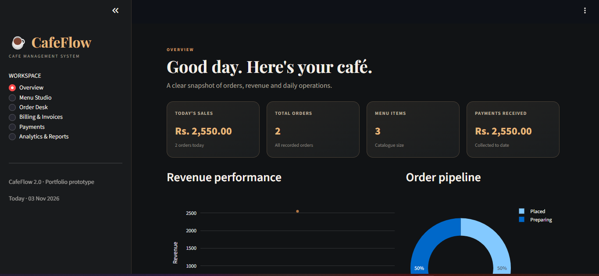
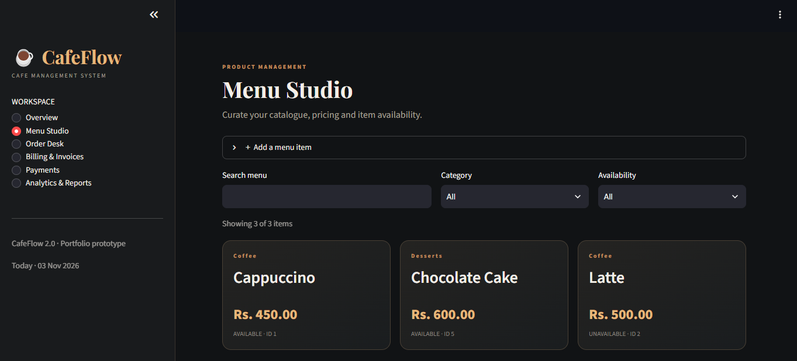
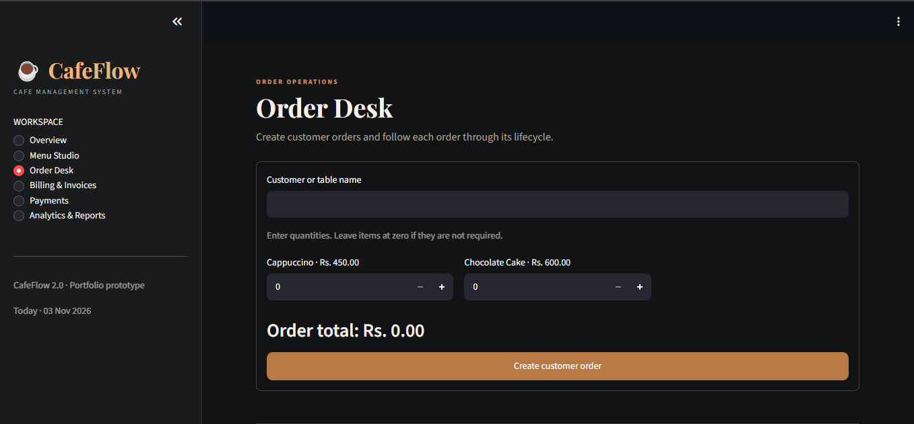
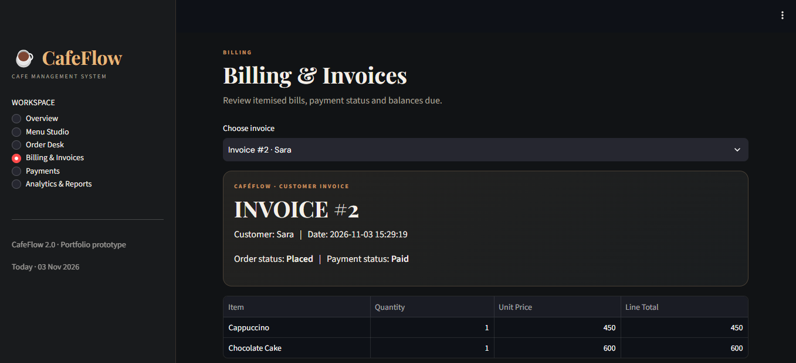
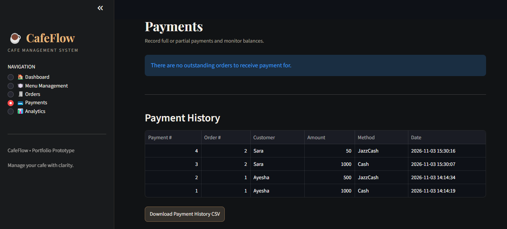
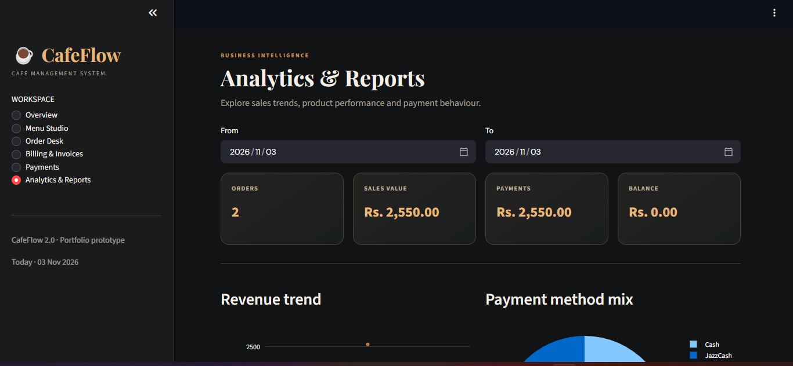

# CafeFlow — Cafe Management System

A web-based cafe management prototype built with Python, Streamlit, SQLite, Pandas, and Plotly.

CafeFlow is designed to simplify everyday cafe operations by bringing menu management, customer orders, billing, payments, and business analytics together in one application.

## Project Overview

Managing a cafe involves several connected activities, including maintaining menu items, recording customer orders, preparing bills, tracking payments, and reviewing sales.

CafeFlow provides a centralised application to help organise these activities and make basic cafe operations easier to manage.

## Main Features

### 1. Dashboard
- View key business metrics.
- Monitor revenue and order summaries.
- Review recent orders.
- Track outstanding payments.

### 2. Menu Studio
- Add new menu items.
- Edit item names, categories, and prices.
- Delete menu items.
- Manage item availability.

### 3. Order Desk
- Create customer orders.
- Select menu items.
- Record item quantities.
- Calculate order totals.
- View and update order statuses.

### 4. Billing & Invoices
- Generate itemised invoices.
- Display customer and order details.
- Calculate item totals and grand totals.
- View payment status.
- Export invoice information.

### 5. Payments
- Record full and partial payments.
- Track payment methods.
- Calculate outstanding balances.
- View payment records.

### 6. Analytics & Reports
- View revenue trends.
- Identify popular menu items.
- Analyse payment methods.
- Filter reports by date.
- Export sales reports as CSV files.

## Screenshots

### Dashboard

### Menu Studio

### Order Desk

### Billing & Invoices

### Payments

### Analytics & Reports

## Technology Stack

| Technology | Purpose |
|---|---|
| Python | Application logic |
| Streamlit | Web application interface |
| SQLite | Database management |
| Pandas | Data handling |
| Plotly | Interactive charts and visualisations |

## Database Design

CafeFlow uses SQLite to store and manage application data.

The database includes tables for:

- Menu items
- Customer orders
- Order items
