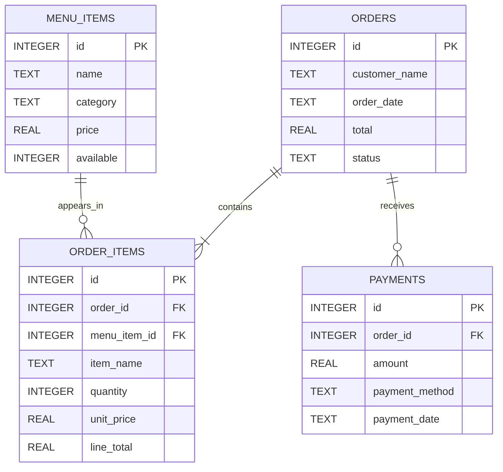

# CafeFlow — Database Design Document

**Version:** 2.0  
**Database:** SQLite

## 1. Introduction

CafeFlow uses SQLite to store and manage information about menu items, customer orders, order details and payment transactions.

The database is designed to maintain relationships between orders, their individual items and associated payments.

## 2. Database Tables

### 2.1 MENU_ITEMS

Stores information about cafe menu products.

| Column | Data Type | Description |
|---|---|---|
| id | INTEGER | Primary Key |
| name | TEXT | Menu item name |
| category | TEXT | Item category |
| price | REAL | Current item price |
| available | INTEGER | Availability status |

### 2.2 ORDERS

Stores customer order information.

| Column | Data Type | Description |
|---|---|---|
| id | INTEGER | Primary Key |
| customer_name | TEXT | Customer name |
| order_date | TEXT | Order date |
| total | REAL | Total order amount |
| status | TEXT | Current order status |

### 2.3 ORDER_ITEMS

Stores individual items associated with each order.

| Column | Data Type | Description |
|---|---|---|
| id | INTEGER | Primary Key |
| order_id | INTEGER | Foreign Key referencing ORDERS |
| menu_item_id | INTEGER | Reference to MENU_ITEMS |
| item_name | TEXT | Item name snapshot |
| quantity | INTEGER | Ordered quantity |
| unit_price | REAL | Price at order time |
| line_total | REAL | Quantity multiplied by unit price |

### 2.4 PAYMENTS

Stores payment transactions.

| Column | Data Type | Description |
|---|---|---|
| id | INTEGER | Primary Key |
| order_id | INTEGER | Foreign Key referencing ORDERS |
| amount | REAL | Payment amount |
| payment_method | TEXT | Payment method |
| payment_date | TEXT | Payment date |

## 3. Primary Keys

Each main table has its own unique identifier:

- MENU_ITEMS.id
- ORDERS.id
- ORDER_ITEMS.id
- PAYMENTS.id

These identifiers distinguish individual records.

## 4. Foreign Keys

The database uses the following relationships:

- ORDER_ITEMS.order_id references ORDERS.id.
- ORDER_ITEMS.menu_item_id identifies the associated menu item.
- PAYMENTS.order_id references ORDERS.id.

## 5. Entity Relationships

- One order can contain multiple order items.
- One order can have multiple payment transactions.
- One menu item can be referenced by multiple order-item records.

## 6. ERD (Entity Relationship Diagram)

## 7. Historical Price Preservation

ORDER_ITEMS stores item names and unit prices as snapshots.

This preserves the historical price used when an order was created, even if the current menu price changes later.

## 8. Data Integrity

The database uses primary keys and foreign-key relationships to organise records.

Order totals and payment balances must be checked consistently by application logic.

## 9. Conclusion

The CafeFlow database supports menu management, order processing, historical billing and payment tracking through four related tables.
Add CafeFlow database design documentation
